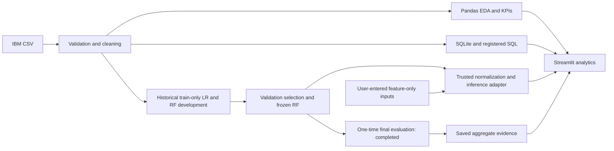
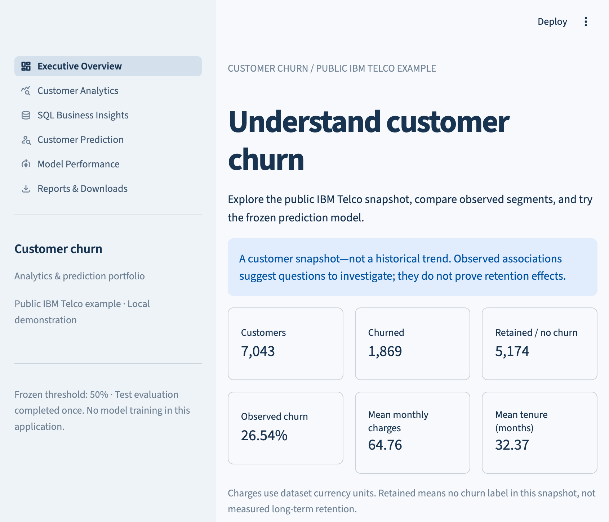
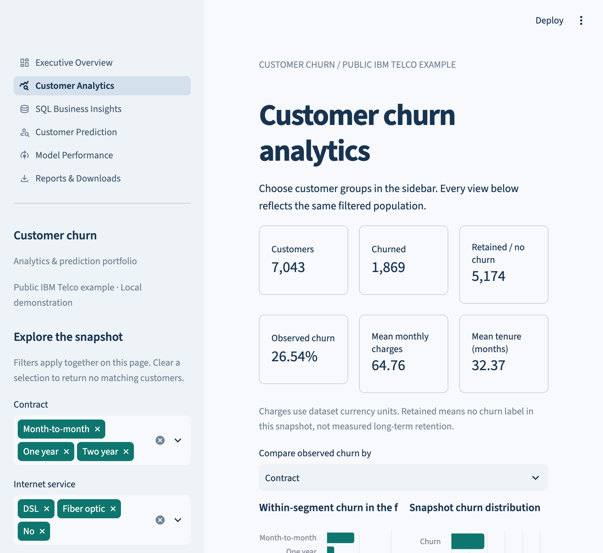
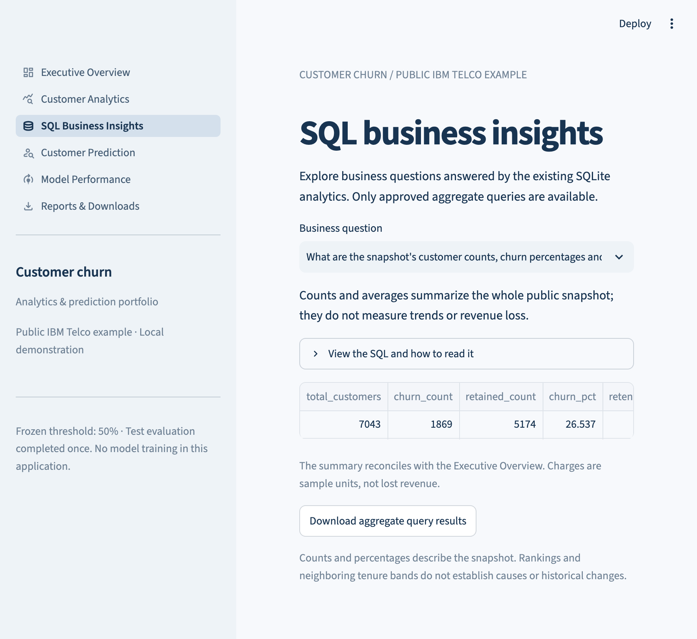
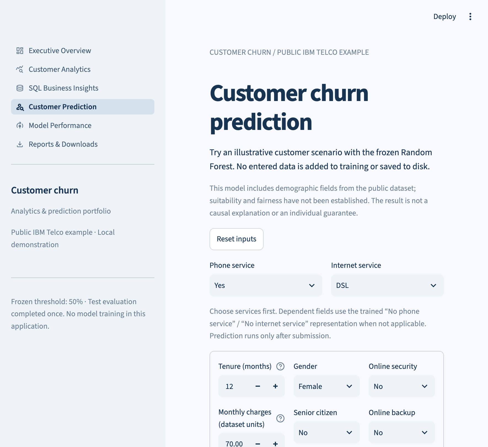
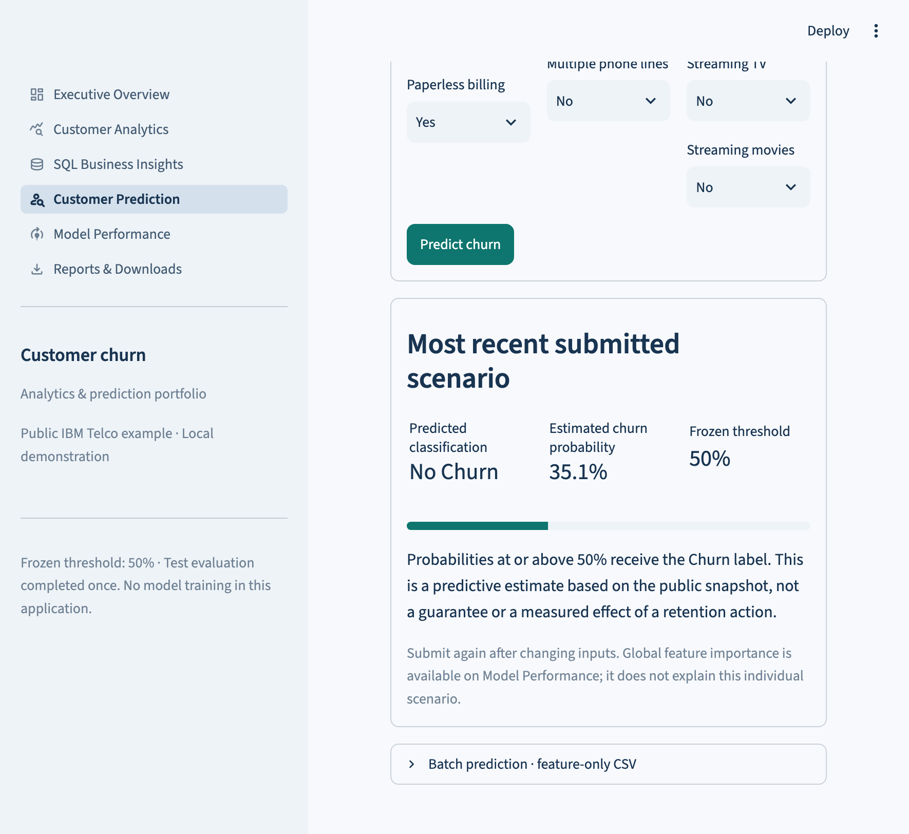
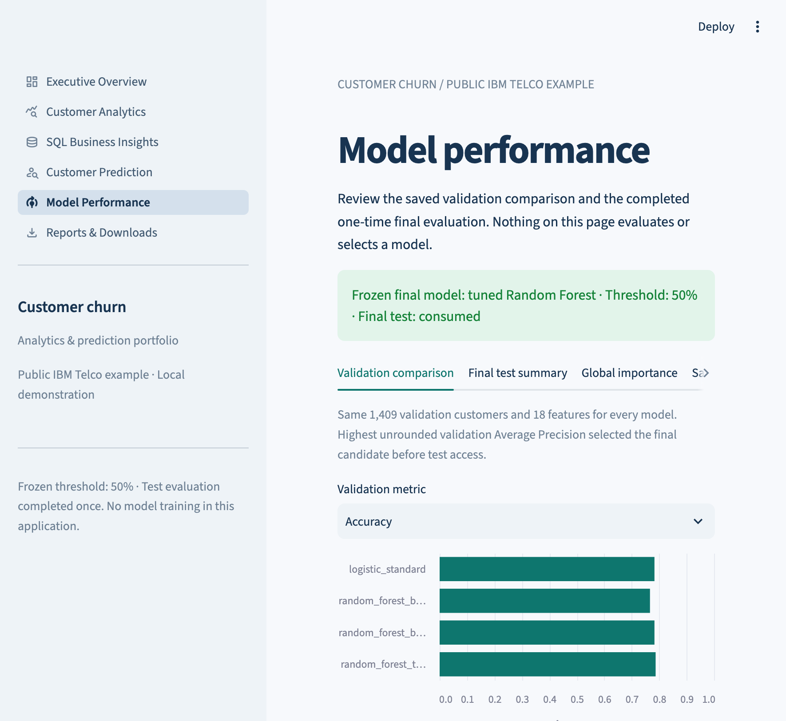
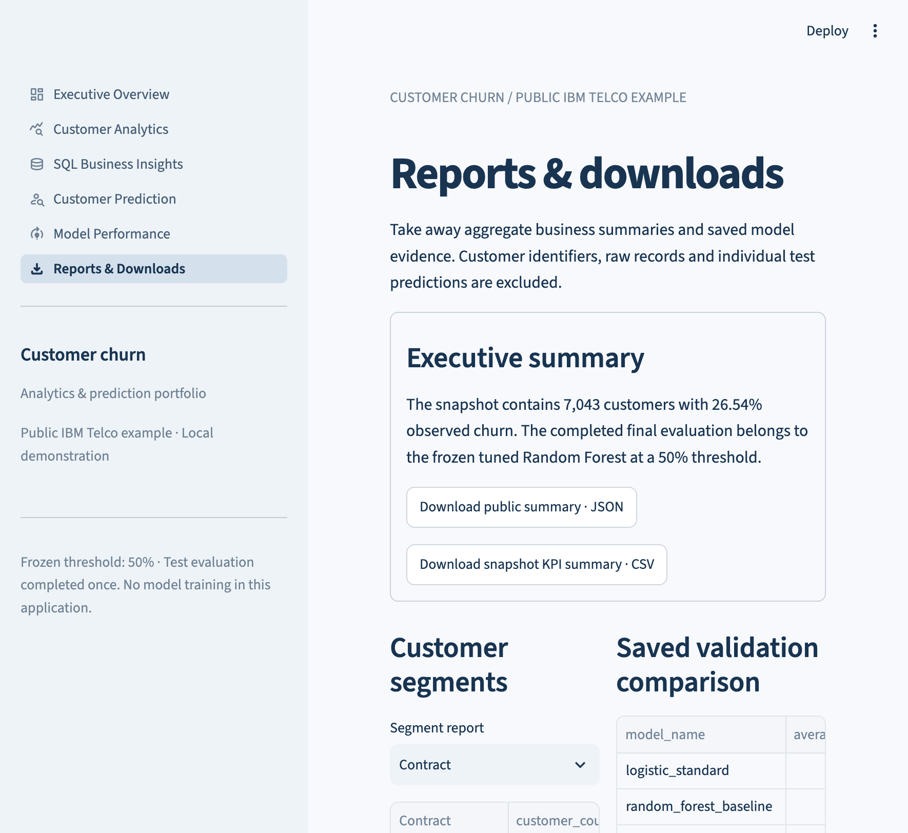

# Customer Churn Prediction & Analytics

A Python and SQL portfolio project that turns the public IBM Telco customer churn
example into a reproducible analytical workflow and a six-page local Streamlit app.
It combines data-quality investigation, statistical EDA, reconciled SQLite analytics
and trusted inference with a frozen Random Forest.

**Publication candidate:** genuine source from the completed seven-phase project.
The complete local project passed Phase 7 QA with limitations. This source release
intentionally excludes datasets, trained models, row-level records and private audit
logs. **A fresh source checkout cannot run the complete dashboard without separately
supplied trusted assets.** No public hosted app or production validation is claimed.
See [asset requirements](docs/PUBLIC_RELEASE_ASSETS.md) and
[current publication verification](docs/PUBLICATION_VERIFICATION.md).

## Business problem

Which customer groups show higher observed churn, and how can a retention analyst
explore those associations and score a new scenario? The project supports those
questions with consistent group denominators and transparent model evidence.
It does not establish that an offer prevents churn or generates retention savings.

## Dataset

| Item | Verified snapshot |
|---|---:|
| Customers | 7,043 |
| Churned / no churn | 1,869 / 5,174 |
| Observed churn | 26.54% |
| Original / analytical columns | 21 / 25 |
| Missing TotalCharges retained | 11 |
| Mean monthly charges | 64.76 dataset units |
| Mean tenure | 32.37 months |

Source: [IBM Telco CSV](https://raw.githubusercontent.com/IBM/telco-customer-churn-on-icp4d/master/data/Telco-Customer-Churn.csv).
This is one example snapshot, not customer histories or verified future operational
outcomes. [Attribution and distribution review](docs/PHASE7_DATA_AND_DISTRIBUTION.md)
distinguishes upstream code-pattern licensing from still-required public asset review.

## Seven-phase project overview

| Phase | Delivered work |
|---|---|
| 1 | Acquisition, canonical schema/domain validation and offline ingestion tests |
| 2 | Deterministic cleaning, EDA, customer KPIs and descriptive business insights |
| 3 | Constrained SQLite schema, SQL analytics and SQL/Pandas reconciliation |
| 4 | Leakage-safe preprocessing, Dummy baseline and Logistic Regression |
| 5 | Training-only RF search, validation comparison, frozen selection and one-time test |
| 6 | Six-page Streamlit analytics and trusted inference dashboard |
| 7 | Integration QA, narrow UI/chart corrections and portfolio documentation |

Historical model development is preserved for technical review. It is not a request
to repeat training or reopen the consumed test set.

## Architecture



The [system architecture guide](docs/PHASE7_SYSTEM_ARCHITECTURE.md) documents module
boundaries, data flows, historical modeling and the permanent test-consumption policy.

## Technology stack

Python, NumPy, Pandas, SciPy, Matplotlib/Seaborn, SQLite, scikit-learn, joblib,
Streamlit, Altair, Jupyter and pytest. No cloud service or external model API is
needed for local use. Plotly was not added because existing native Altair charts
meet the interactive-chart need.

## Cleaning, EDA and business insights

The original CSV is preserved separately. Whitespace-only TotalCharges entries
occurred for zero-tenure customers; they remain missing with a flag rather than
being assumed zero. Cleaning validates IDs, domains, numeric ranges and service
consistency while retaining every row. Analytical bands are fixed and reproducible.

EDA includes distributions, group comparisons, multivariate segment views,
correlations and documented exploratory association summaries. Empty rates remain
undefined, group counts are visible and small groups are flagged.

Examples of observed associations:

- Month-to-month churn: **42.7%**, n=3,875; two-year: **2.8%**, n=1,695.
- Tenure 0–12 months: **47.4%**, n=2,186; 61+ months: **6.6%**, n=1,407.
- Electronic-check payment: **45.3%**, n=2,365; automatic credit card: **15.2%**, n=1,522.

These motivate investigations or prospective experiments. They do not demonstrate
causal effects, historical trends, CLV, lost revenue or ROI.

## SQL analytics

The existing constrained SQLite schema and 20 checked-in business queries cover
KPIs, joins, segments, rankings, window functions, missing coverage and parameterized
summaries. **97 SQL/Pandas checks** reconcile the definitions. The app exposes nine
aggregate questions through readonly connections, query_only, an authorizer and
validated bound parameters. It has no unrestricted SQL editor.

## Model development and comparison — historical evidence

Exactly the original seed-42 customer membership was reused: **4,225 train,
1,409 validation, 1,409 test**. All candidates use the same 18 eligible predictors.
IDs, target columns and uncertain cumulative-charge fields stay excluded.
Preprocessing is inside training Pipelines and inside each CV fold.

Historical Phase 5 used an eight-candidate, three-fold training-only RF search with
Average Precision. Highest unrounded validation AP selected the final candidate;
threshold stayed **0.50**. No calibrator or train+validation refit was used.

| Candidate | Validation AP | ROC-AUC | Precision | Recall | F1 |
|---|---:|---:|---:|---:|---:|
| Logistic Regression | 0.606301 | 0.821801 | 0.604938 | 0.524064 | 0.561605 |
| RF baseline | 0.589939 | 0.809353 | 0.611111 | 0.500000 | 0.550000 |
| Balanced RF | 0.578163 | 0.806094 | 0.553191 | 0.625668 | 0.587202 |
| **Tuned RF** | **0.624140** | **0.825082** | **0.617089** | **0.521390** | **0.565217** |

The selected RF has 150 trees, depth 6, minimum leaf size 2, max_features=0.5,
no class weight and seed 42. A small point-score difference on one validation
sample is not proof of general superiority. Importance/calibration diagnostics
have their own documented limitations and do not explain individual causes.

## Saved final performance and permanent boundary

The selected model/protocol were frozen before **one** final evaluation on 1,409
customers. These are saved results, not metrics recomputed during final QA:

| Metric | Final test |
|---|---:|
| Accuracy | **79.06%** |
| Precision | **63.21%** |
| Recall | **50.53%** |
| F1 | **56.17%** |
| ROC-AUC | **0.8430** |
| Average Precision | **0.6632** |
| Brier score | 0.137102 |

Confusion matrix: **TN=925, FP=110, FN=185, TP=189**.
Recall of approximately 50.5% means the frozen threshold misses a meaningful
fraction of churners: 185 of the 374 churn-labeled test customers. These labels do
not establish that an intervention could have prevented their churn.
Exact stored aggregates are copied to [public_results/summary.json](public_results/summary.json).
The authoritative `reports/phase5/test_consumption.json` remains consumed.
Do not retrain/reselect, change the threshold, delete the ledger or evaluate that
test again. Existing Phase 4 reservation flags are historical. The dashboard reads
saved aggregate evaluation evidence only.

## Interactive dashboard and example use

Six pages provide:

1. Executive Overview with six KPIs and observed segment signals.
2. Customer Analytics with coordinated filters, distributions and group comparisons.
3. SQL Business Insights with curated readonly questions and aggregate export.
4. Customer Prediction with a proper form, service dependencies and fixed-threshold scoring.
5. Model Performance with stored comparisons, final aggregates and global importance.
6. Reports & Downloads with safe summaries and methodology.

The F01 inference adapter normalizes numeric/string SeniorCitizen consistently;
F02 keeps canonical acquisition strict. Batch scoring accepts at most **500 rows /
1 MiB**, exact feature headers and no IDs/targets. Uploads stay in memory and are
not globally cached or saved as new training data. The [demo guide](docs/PHASE7_DEMO_GUIDE.md)
uses invented customer inputs only.

## Installation and required local assets

Prefer the existing compatible `.venv`. Verified: Python 3.13.9, Streamlit 1.66.1,
Altair 6.3.0, Pandas 2.3.3, NumPy 2.5.4, sklearn 1.9.1 and joblib 1.6.0.
`requirements.txt` contains ranges; `requirements-demo-verified.txt` records direct
reference versions. A fresh dependency installation or cross-platform build has
not been executed, and package changes require owner approval.

A source-only checkout is **not** a self-contained demo. The public source contains
no raw/cleaned CSV, SQLite database, joblib model, selection/split manifest or ledger.
See [the exact dependency map and trusted asset policy](docs/PUBLIC_RELEASE_ASSETS.md).
No approved public asset download is currently available. Do not reconstruct missing
assets by retraining, bypassing integrity checks or rerunning final evaluation.

For an independently approved new environment, the proposed setup is below. It was
**not executed** during publication preparation; no packages were installed or upgraded:

```bash
python3.13 -m venv .venv
source .venv/bin/activate
python -m pip install -r requirements-demo-verified.txt
python -m pip install --no-deps -e .
```

The verified version file records existing direct dependencies; it is not a complete
transitive lock or proof that a fresh package-index build succeeds. Obtain separately
approved trusted assets before attempting the full dashboard.

## Local execution

From the existing project root:

```bash
source .venv/bin/activate
python -m streamlit run app/Home.py
```

Use the printed localhost URL. Optional port: `--server.port=8517`. No public
deployment occurs. The app resolves assets relative to the project and loads only
the trusted selected artifact through the existing adapter.

## Dashboard screenshots

Actual captures from the final running local application, taken during publication
preparation. Prediction inputs are invented; results are illustrative. These images
show the complete owner-held app with trusted assets, not an asset-free checkout.



| Analytics | SQL insights |
|---|---|
|  |  |

| Prediction form | Invented prediction result |
|---|---|
|  |  |

| Saved model performance | Aggregate downloads |
|---|---|
|  |  |

See [capture provenance and viewport limitations](docs/screenshots/README.md).
The outdated before-fix QA image is excluded. Tablet/mobile interaction coverage
and comprehensive accessibility assessment remain incomplete.

## Testing and final QA

```bash
python -m pytest -q
```

Phase 7 full-suite record: **230 passed, 0 failed, 0 skipped**.
See [publication verification](docs/PUBLICATION_VERIFICATION.md) for the fresh isolated rerun.
The full suite includes app integration tests requiring the withheld trusted assets;
it is not claimed to pass from an assets-free checkout. An executed source-only
subset and its exact command are recorded in that guide. Existing tests use synthetic
fixtures; new QA does not fit existing models or reopen held-out evaluation.
Final integration checks all six pages, nine filters, nine exposed SQL questions,
97 reconciliation checks, batch limits/header ordering and safe exports.

Phase 7 corrected numerical histogram bins that were previously sorted as strings,
and improved narrow-viewport KPI/header layout. It added four narrowly scoped
regressions; it did not alter models, splits, thresholds or prior analytical results.
Historical verification and private audit evidence remain with the owner; they are
not included in the public source. The public verification summary contains aggregate
results without machine paths or customer IDs.

## Project structure and guides

```text
app/                         Streamlit entry and six page scripts
src/churn_analytics/          ingestion, cleaning, analytics, SQL and historical modeling
src/churn_analytics/dashboard/ read-only application services and views
sql/                         schema, indexes and 20 analytical queries
tests/                       offline synthetic and application regressions
notebooks/                   historical analyses and safe saved-evidence notebook
models/, data/, reports/     trusted local assets; not implicitly public releases
docs/                        architecture, demo, deployment, interviews and attribution
```

- [System architecture and integrity](docs/PHASE7_SYSTEM_ARCHITECTURE.md)
- [Three-to-five-minute demo](docs/PHASE7_DEMO_GUIDE.md)
- [55 interview answers and presentations](docs/PHASE7_PORTFOLIO_INTERVIEW_GUIDE.md)
- [Application setup/troubleshooting](docs/PHASE6_STREAMLIT_GUIDE.md)
- [Deployment readiness](docs/PHASE7_DEPLOYMENT_READINESS.md)
- [Data, license and distribution review](docs/PHASE7_DATA_AND_DISTRIBUTION.md)

## Limitations and future work requiring approval

This is one public example snapshot with uncertain feature timestamps, earlier
full-data EDA and repeated validation use. Calibration, demographic suitability,
dataset shift and prospective operational performance remain limited/unverified.
No fairness guarantee, causal retention gain, production security certification or
secure multi-user hosting claim is made.

Further work could complete browser/platform checks and plan prospective monitoring/
evaluation with new data. It must not reuse this consumed test to tune. A future
public repository/release/hosting plan needs owner approval, licensing/privacy
review and a compatible environment build. Publication preparation stops at Gate 1. No Git initialization, commit, push,
cloud deployment or additional development phase has been performed.

## Dataset attribution and project licensing

The public source is the [IBM repository](https://github.com/IBM/telco-customer-churn-on-icp4d).
Its Apache 2.0 code-pattern license is retained under `docs/third_party/`.
Dataset/derived-asset redistribution remains unresolved, so those assets are withheld.
The owner has not selected a root software license. This is not currently presented
as an openly licensed project; third-party terms remain applicable. See the
[publication licensing review](docs/PUBLIC_RELEASE_LICENSING.md).
