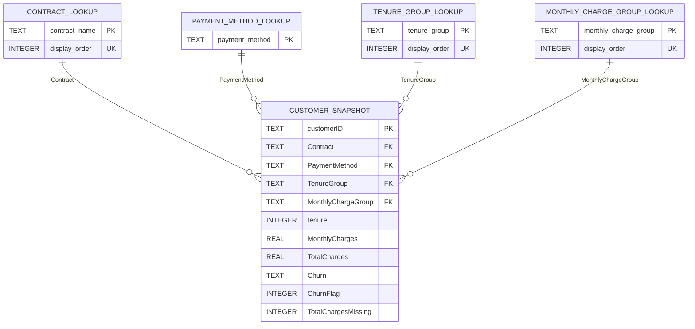

> Publication-copy note: this guide documents the historical complete local
> project. Trusted datasets/models/provenance and private audit logs are withheld
> from this source release. See [asset requirements](PUBLIC_RELEASE_ASSETS.md),
> [current verification](PUBLICATION_VERIFICATION.md) and
> [new authentic captures](screenshots/README.md). Historical development commands
> are for review; do not retrain frozen models or reopen the consumed test.

# Phase 3 SQL guide and interview preparation

Phase 3 reads the existing Phase 2 artifact, not a newly cleaned dataset. The
purpose is reliable SQL analysis of a customer snapshot. There are no fabricated
transactions, events, subscription histories or monthly observations.

## Files and execution

| New file/path | Purpose |
| --- | --- |
| `src/churn_analytics/database.py` | Validated, parameterized transactional loading; managed-schema ownership checks; foreign keys and integrity checks |
| `src/churn_analytics/sql_analytics.py` | Allowlisted query names, safe parameters, full-row round trip, SQL/Pandas reconciliation |
| `src/churn_analytics/sql_performance.py` | Measured before/after-index comparison on an in-memory copy |
| `src/churn_analytics/sql_reporting.py` | Business questions, actual results, interpretations, caveats and reconciliation Markdown |
| `src/churn_analytics/phase3.py` | Complete workflow and read-only named-query CLI |
| `sql/schema.sql` | Explicit STRICT types, primary/foreign keys, domain and consistency constraints |
| `sql/indexes.sql` | Contract/tenure covering index and payment-method index |
| `sql/queries/01_…20_*.sql` | Twenty separate business queries; catalog in `sql/README.md` |
| `tests/test_database.py` | Temporary DB creation, constraints, NULLs, repeatability, rollback, ownership and schema drift |
| `tests/test_sql_analytics.py` | Known-answer KPIs/medians, joins, empty groups, rankings, reconciliation and measured benchmark checks |
| `tests/test_phase3.py` | CSV-to-database-to-report integration, input preservation and CLI parameters |
| `data/database/.gitkeep` | Retains the database directory in Git; generated DB stays ignored |
| `docs/PHASE3_SQL_GUIDE.md`, `sql/README.md` | Teaching material and query-running instructions |
| `PHASE3_VERIFICATION.md` | Executed checks, actual metrics, performance observations and limitations |

README and `.gitignore` are extended. Phase 1/2 modules, tests, notebooks,
verification records and data artifacts are preserved. No new dependencies are
needed: `sqlite3` is built into Python. This implementation checks for SQLite
>=3.37 and was verified with the project's Python-linked SQLite, not a separately
installed database server.

Generated files:

- `data/database/customer_churn.db`
- `reports/PHASE3_SQL_BUSINESS_INSIGHTS.md`
- `reports/phase3/query_results/`: 20 unrounded CSV result tables
- `reports/phase3/sql_pandas_reconciliation.csv`, `.json`, `.md`
- `reports/phase3/query_performance.json`: actual timings, plans and parameters
- `reports/phase3/phase3_manifest.json`: row counts, source hashes, SQL KPIs and checks
- `reports/phase3/pre_phase3_backup_2026-10-28.tar.gz` and preservation hash records

At inspection time this folder was not a Git repository. An initial Git commit
is recommended. The local backup archive captures the prior source, configuration,
notebooks, raw/processed data and selected report records; it excludes the virtual
environment and is not a second project directory. Generated data/reports/backups
remain ignored by Git. Regenerate outputs after cloning.

From the project root:

```bash
source .venv/bin/activate
python -c 'import sqlite3; print(sqlite3.sqlite_version)'
python -m churn_analytics.phase3
python -m churn_analytics.phase3 --query 02_contract_segments
python -m churn_analytics.phase3 --query 11_service_combinations --params '{"min_customers":500}'
python -m churn_analytics.phase3 --query 20_filtered_contract_tenure --params '{"contract":"Two year","min_tenure":0,"max_tenure":12}'
python -m pytest -q
```

Optional full-workflow arguments are `--cleaned-path`, `--database-path`,
`--reports-dir` and `--benchmark-repeats`. Named-query mode uses only the existing
database plus bound `--params`. It opens the DB read-only and rejects SQL/path
injection through query names. If the Phase 2 CSV is missing, the workflow stops
with instructions instead of silently performing alternative cleaning.

## Relational model and grain



The ER diagram lists key/analytical fields; the snapshot retains **all 25** Phase 2
columns. It has one row per customerID, not one row per month or transaction.
Each dictionary row relates to zero or many snapshot customers; each customer
references exactly one row in each applicable lookup (non-null foreign keys).

Contract and payment keys are real, distinct source labels rather than invented
surrogate identities. Contract display order describes term ordering, not time.
Tenure/charge dictionaries describe Phase 2's existing fixed bins and their order;
unused analytical bins are allowed so empty groups can remain visible. None of
these JOINs represents multi-source integration. Natural text keys are adequate
for this small, stable vocabulary; a larger operational system may need separately
governed surrogate identifiers and history, which are outside this phase.

## Loading, constraints and idempotency

1. `load_cleaned_dataset()` restores the Phase 2 CSV types and validates its
   existing policy. No Phase 3 cleaning or financial imputation occurs.
2. The database loader validates again before opening a destination. An empty
   database gets the checked-in schema. An existing database must have the
   application's ownership ID, schema version and exact expected table constraints;
   unrelated databases or schema drift are rejected before snapshot replacement.
3. Every connection enables `PRAGMA foreign_keys=ON`. SQLite requires enabling
   this per connection; using the Python helper avoids silently skipping it.
4. `BEGIN IMMEDIATE` starts a transaction. Delete child rows before parent lookups,
   repopulate real category lookups/fixed-bin metadata, then bind every customer
   value using `executemany()` placeholders. Never use f-strings for input values.
5. NaN maps to Python None and then SQL NULL. Binary flags become checked 0/1
   INTEGERs; floats become REAL and labels/IDs TEXT. Category ordering is explicitly
   restored by dictionary order, not assumed from TEXT sorting.
6. Validate integrity, foreign keys, row counts, unique IDs and NULL counts before
   commit. Any insertion error rolls back the whole snapshot refresh. A test injects
   a failing trigger and proves that the previous snapshot survives.
7. Compare all 25 customer fields with the input after restoring Pandas types.
   SQL/Pandas aggregates are then independently reconciled. Hashes verify that the
   processed CSV and available original raw CSV remain unchanged.

Repeated loading replaces the current snapshot, not appends duplicate customers.
This is an intentionally single-snapshot design, not historical ingestion. Primary
keys prevent duplicates, CHECK constraints enforce numeric/category/derived rules,
and foreign keys enforce lookup membership. STRICT types reject values that cannot
be losslessly converted to the declared storage type; they are not a guarantee of
business accuracy. All required fields except cumulative charges are NOT NULL.
SQL constraints also check missing-charge flags, zero-tenure missingness, target
flags, fixed bin boundaries and phone/internet service consistency.

## KPI definitions and NULL behavior

Churn percentage is `100.0 * SUM(ChurnFlag) / COUNT(*)`. Non-churn percentage is the
share with Churn=No, not measured retention over a dated business interval.
Charges use dataset charge units and are not revenue loss, CLV or savings.
`AVG(TotalCharges)` ignores NULLs; pair it with `COUNT(TotalCharges)` for coverage.
`COUNT(*)` includes customer rows even when a charge is NULL. `= NULL` is not a
missingness test; use `IS NULL`. Undefined percentages use `NULLIF(n,0)` and remain
NULL rather than becoming zero. `COALESCE` is used for legitimate empty counts,
never to invent financial amounts or empty-group churn percentages.

Counts must reconcile exactly. Float comparisons use absolute and relative
1e-10 tolerances for SQL/Pandas summaries; full customer round trips use 1e-12.
SQL percentages are compared with **100 ×** Pandas proportions. These checks use
unrounded results; only report presentation is rounded. Outer merges expose
missing/extra segment keys instead of silently discarding mismatches.

## Step-by-step query walkthroughs

### 1. Overall KPIs and portable median — query 01

**Input:** all snapshot customers with non-null monthly charges. **Intermediate:**
`ordered_charges` sorts charges with a stable customerID tie-break, numbers rows
from 1, and repeats total n on each row. Positions `(n+1)/2` and `(n+2)/2` use
intentional integer division. For odd n they identify the same middle row; for
even n they identify two rows. **Final:** AVG of those positions is the median;
conditional aggregates produce all other KPIs. For the IBM artifact n=7,043,
position 3,522 gives 70.35. Query 15 repeats the method separately within each
Churn group, including its even-sized No group. Tests cover both odd and even n.

**Significance:** a portable median does not require an optional SQLite extension.
**Mistakes:** averaging all charges instead of the middle positions, using the
whole-sample median for each outcome, or integer division in percentages. Empty
snapshots return zero counts and undefined median/rates safely.

### 2. LEFT JOIN and correct denominators — query 02

**Input:** real contract labels plus customers. **Intermediate:** LEFT JOIN each
label to matching snapshot rows. **Final:** count matched customerID values, sum
churn flags and divide by that contract's matched customers. The IBM results are
1,655/3,875=42.71%, 166/1,473=11.27%, and 48/1,695=2.83% for month-to-month,
one-year and two-year contracts respectively.

**Significance:** compare prevalence while retaining dictionary groups with no
matching rows. **Mistakes:** `COUNT(*)` counts an unmatched LEFT JOIN placeholder
as one; dividing by all customers changes the question; filtering the right table
in WHERE can accidentally remove empty groups.

### 3. Rate versus contribution — query 12

**Input:** snapshot rows. **Intermediate:** the CTE creates three contract-level
rows with counts and rates. **Final:** RANK orders rates, DENSE_RANK orders churn
volumes, and window SUM supplies total churn while preserving each segment row.
Month-to-month has a 42.71% within-segment rate and accounts for
1,655/1,869=88.55% of all churned customers: two different denominators.

**Significance:** combine prevalence and volume when choosing what to investigate.
**Mistakes:** interpreting share of churn as a churn probability or claiming
rankings estimate a causal effect. Small groups need sample-size context.

### 4. LAG/LEAD and a cumulative window — query 13

**Input:** the ordered six fixed tenure groups. **Intermediate:** aggregate
customers/outcomes per band. **Final:** LAG/LEAD expose adjacent group rates;
window SUM with an explicit ROWS frame accumulates group populations. The first
two rates are 47.44% and 28.71%, a difference of -18.73 percentage points; the
final cumulative count is 7,043.

**Significance:** describe the snapshot's tenure composition. **Mistakes:** calling
this a monthly improvement, following individual customers through time, sorting
labels lexically, or replacing missing neighbors with invented rates. Survivor
selection and unequal band widths matter.

### 5. Within-contract rankings — query 16

**Input:** one charge per snapshot customer. **Intermediate:** partition by
contract, calculate ROW_NUMBER, RANK, DENSE_RANK and the contract mean before
filtering. **Final:** return the top n row positions and their difference from the
full contract mean. A synthetic test with charges 100,100,50 demonstrates row
positions 1,2,3; price ranks 1,1,3; distinct-price ranks 1,1,2. This is a labeled
teaching fixture, not a claimed IBM finding.

**Significance:** useful for billing/plan review, not churn prediction. **Mistakes:**
filtering before calculating the mean, omitting deterministic tie-breaks, or
assuming ROW_NUMBER includes all equal-price ties at the cutoff.

### 6. HAVING, CTE and an overall-rate subquery — query 14

**Input:** contract/internet groups. **Intermediate:** GROUP BY forms groups;
HAVING requires n>=100; the CTE calculates their rates. **Final:** a scalar
subquery supplies overall churn (26.54%), and the outer WHERE retains groups above
it. The IBM result contains month-to-month/fiber (1,162/2,128=54.61%) and
month-to-month/DSL (394/1,223=32.22%).

**Significance:** transparently focus further investigation on populated groups.
**Mistakes:** HAVING before grouping, confusing WHERE and HAVING, implying n=100
proves statistical reliability, or calling the filter a trained risk threshold.

### 7. Parameterized filtering and a covering index — query 20

**Input:** the contract and tenure interval supplied as bound values. **Final:**
the default Two year, tenure 0–12 inclusive selects 68 customers, zero observed
churn labels and mean monthly charges 30.946324. This does not imply zero future
risk. **Intermediate access:** the index begins with equality on Contract, then
the range on tenure; MonthlyCharges/ChurnFlag cover all aggregate inputs. With
this access plan SQLite can answer from the index without fetching snapshot rows.

**Significance:** a real contract/onboarding question supplies a relevant benchmark.
**Mistakes:** interpolating values into SQL, assuming an index is always chosen,
or timing an unexecuted EXPLAIN statement as if it were the actual query.

## Index selection and measured query-plan review

The contract/tenure/charges/flag covering index supports equality plus range
filtering; a separate payment-method index supports the other lookup/grouping key.
Indexes are not added to every low-cardinality flag. Additional indexes consume
storage and impose write/refresh work. The snapshot primary key and unique lookup
keys already create supporting unique indexes.

`EXPLAIN QUERY PLAN` gives a high-level access plan, not measured runtime. In the
verified run the benchmark changed from `SCAN customer_snapshot` to a
`SEARCH ... USING COVERING INDEX` with contract/range constraints. Exact strings
and node numbers are version-dependent, so tests do not demand a fixed plan text.

The benchmark copies the database into memory, disables automatic indexes and
prepared-statement caching, removes only the covering index on the copy, runs
ANALYZE, warms five times, and measures 100 executions with `perf_counter_ns()`.
It creates the index on the copy, updates statistics, warms and measures again.
Every execution fetches the result; indexed and unindexed results must match.
The original database/indexes remain intact. Index construction, database copy,
storage and write costs are excluded; Python preparation/execute/fetch overhead
is included. Blocks are sequential, so noise/cache/system activity can affect the
comparison. Actual timing values live in the generated JSON and verification
record; no fixed speedup is promised.

## SQLite versus PostgreSQL

| Topic | SQLite used here | PostgreSQL comparison |
| --- | --- | --- |
| Typical use | Embedded, local file; no server administration | Client/server shared data and concurrent multi-user workloads |
| Types | STRICT INTEGER/REAL/TEXT; 0/1 flags | Native boolean, numeric and other richer types; choose appropriate precision |
| Median | Ordered-position/window method, avoiding optional extensions | Ordered-set `percentile_cont(0.5) WITHIN GROUP (ORDER BY charge)` is available |
| Group/window SQL | CTEs, joins, window functions supported | Similar concepts, but dialect, casting and driver parameter syntax require review |
| Indexes | B-tree indexes sufficient for this small snapshot | B-tree plus options such as Hash, GIN, GiST and BRIN for suitable workloads |
| Plans | `EXPLAIN QUERY PLAN` for access strategy; time executions separately | `EXPLAIN` estimates; `EXPLAIN (ANALYZE, BUFFERS)` executes and reports actual plan details |

No PostgreSQL installation, query execution or benchmark is claimed. Sources:
[SQLite usage](https://www.sqlite.org/whentouse.html),
[STRICT types](https://www.sqlite.org/stricttables.html),
[SQLite window functions](https://www.sqlite.org/windowfunctions.html),
[SQLite plans](https://www.sqlite.org/eqp.html),
[PostgreSQL aggregates](https://www.postgresql.org/docs/current/functions-aggregate.html),
[index types](https://www.postgresql.org/docs/current/indexes-types.html),
[EXPLAIN](https://www.postgresql.org/docs/current/using-explain.html).

## Twenty-five interview questions and concise model answers

1. **What is your snapshot table's grain?** One record per customerID, with one
   observed churn label; no customer-month or transaction grain is invented.
2. **What does a primary key guarantee?** Unique non-null identity. customerID is
   an explicit TEXT primary key, preserving source identifiers.
3. **What does a foreign key add?** Each contract/payment/group label must reference
   a lookup row. Enforcement is enabled per connection, not merely declared.
4. **Why use natural text keys here?** Categories are few and already meaningful;
   extra surrogate IDs would add mapping complexity without a current need.
5. **How do INNER and LEFT JOIN differ in this project?** INNER JOIN attaches a
   matching payment dictionary; LEFT JOIN retains contract/bin dictionary rows
   even without matching customers.
6. **Why count customerID after LEFT JOIN?** It counts matched customers, whereas
   COUNT(*) also counts an unmatched placeholder row.
7. **What is a CTE?** A named intermediate SELECT. Here it separates per-segment
   aggregation from ranking and comparison with the overall rate.
8. **WHERE versus HAVING?** WHERE filters input rows; HAVING filters grouped
   results, such as minimum customer counts.
9. **What is conditional aggregation?** Aggregate CASE expressions, for example
   counting zero-tenure records or missing charges in the KPI query.
10. **How do you calculate churn correctly?** Sum the validated 0/1 target and
    divide by the customers in the requested population; multiply by 100.0.
11. **What is the overall rate in your actual data?** 1,869/7,043 = 26.54%; 5,174
    records are labeled No. Neither is a dated operational retention metric.
12. **Rate versus share of churn?** Month-to-month churn is 1,655/3,875 = 42.71%,
    while that group contributes 1,655/1,869 = 88.55% of all churned customers.
13. **How is a SQLite-compatible median calculated?** Number sorted observations,
    identify one/two middle positions and average their values; use PARTITION BY
    when separate outcome-group medians are needed.
14. **ROW_NUMBER versus RANK versus DENSE_RANK?** Unique row positions; shared
    tied ranks with gaps; shared tied ranks without gaps. Tie behavior affects
    top-n selection and interpretation.
15. **Why PARTITION BY Contract?** It resets charge rankings and the mean for
    each contract while retaining one output row per selected customer.
16. **How are LAG and LEAD meaningful here?** They compare adjacent ordered tenure
    bands. These comparisons are cross-sectional, not historical changes.
17. **Why specify ROWS for cumulative sums?** It makes the intended running
    aggregation frame explicit; dictionary ordering supplies stable band order.
18. **What does NTILE do, and what is its limitation?** It divides ordered rows
    into near-equal populations; equal charge values can cross tile boundaries.
19. **How is a subquery used?** Query 14 compares each eligible segment rate with
    the scalar overall sample rate computed from all snapshot customers.
20. **How do you prevent SQL injection?** Bind values with placeholders and
    allowlist query names; do not concatenate arbitrary identifiers or user SQL.
21. **Why preserve financial NULLs?** Missing charges are unknown, not confirmed
    zeros. AVG ignores NULLs, so explicitly report observed coverage.
22. **What makes a covering index useful?** Its key/order supports the filter and
    contains all columns needed by the query; row fetches may be avoided.
23. **Does EXPLAIN QUERY PLAN measure speed?** No. It describes access strategy;
    actual executions were separately timed, fetched and compared for equality.
24. **How do you validate SQL against Pandas?** Recompute from the same unchanged
    Phase 2 artifact, compare exact counts and tolerance-based floats, outer-join
    segment keys, and check a complete 25-column customer round trip.
25. **What business conclusion can you defend?** Some populated segments have
    higher observed churn (for example month-to-month/fiber at 54.61%). This
    motivates research, not a claim that changing a service causes retention.

Stop at Phase 3. Model training and the dashboard require later explicit requests.
