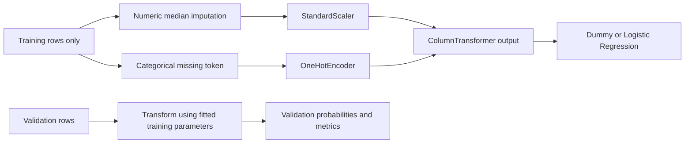

> Publication-copy note: this guide documents the historical complete local
> project. Trusted datasets/models/provenance and private audit logs are withheld
> from this source release. See [asset requirements](PUBLIC_RELEASE_ASSETS.md),
> [current verification](PUBLICATION_VERIFICATION.md) and
> [new authentic captures](screenshots/README.md). Historical development commands
> are for review; do not retrain frozen models or reopen the consumed test.

# Phase 4 — modeling guide and interview preparation

This is an exploratory portfolio classifier of recorded churn labels, not a
production-validated future customer-risk system. Phase 4 uses training/validation
customers only. The 20% test partition is reserved for a later authorized phase.

## Files and architecture

| New file | Purpose |
| --- | --- |
| `src/churn_analytics/model_splits.py` | Target validation, seed-42 stratification, fingerprinted split manifest, coverage checks and train/validation-only data access |
| `src/churn_analytics/modeling.py` | Explicit feature policy, preprocessors, Dummy/LR pipelines, ID/role guards, convergence checks, metrics and aligned coefficient interpretation |
| `src/churn_analytics/model_plots.py` | Validation confusion matrices, ROC/PR curves, probability distributions and selected-model coefficient chart |
| `src/churn_analytics/model_reporting.py` | Calculated validation comparison and business/technical Markdown report |
| `src/churn_analytics/phase4.py` | Reproducible orchestration, predeclared rule, training-only fitting, selected artifact and validation-only reload verification |
| `tests/test_modeling.py` | Fast synthetic-data tests for splitting, target/feature leakage, train-only statistics, guards, metrics, serialization and workflow |
| `notebooks/04_logistic_regression.ipynb` | Executable educational notebook using the shared package |
| `docs/PHASE4_MODELING_GUIDE.md` | This file, concept explanations, questions and interview presentation |
| `PHASE4_VERIFICATION.md` | Actual commands, versions, split sizes, convergence, metrics, notebook/test results and preservation evidence |
| `models/.gitkeep` | Tracks the empty model directory; generated model files are ignored |

README and dependency declarations are extended. `joblib` is now a direct
requirement rather than only a scikit-learn transitive dependency; the installable
package declares sklearn/joblib for its modeling modules. `.gitignore` excludes
generated model contents. Prior source/tests/notebooks/data/SQL are preserved.
The pre-change archive and preservation fingerprints are under `reports/phase4/`.
At inspection time Git was still uninitialized; an initial commit is recommended.

### Generated artifacts

| Path | Meaning |
| --- | --- |
| `models/logistic_regression_pipeline.joblib` | Selected, already training-fitted preprocessing + Logistic Regression Pipeline |
| `reports/PHASE4_LOGISTIC_REGRESSION_REPORT.md` | Actual development results, policy, interpretation and limitations |
| `reports/phase4/split_manifest.json` | All split IDs, administrative class counts, seed, source SHA-256 and reserved-test status |
| `reports/phase4/split_assignments.csv` | One row per customer: ID and assigned split, no model predictions |
| `reports/phase4/run_config.json` | Selection criterion and configuration persisted before fitting |
| `reports/phase4/environment.json` | Actual runtime and dependency versions |
| `reports/phase4/feature_policy.csv` | All 25 source columns, inclusion/exclusion and rationale |
| `reports/phase4/metrics.json` | Dummy/standard/balanced train and validation metrics, supports, probabilities and convergence |
| `reports/phase4/validation_metrics.csv` | Three-candidate validation comparison at threshold 0.50 |
| `reports/phase4/validation_predictions.csv` | Selected model, one row per validation customer; never final-test predictions |
| `reports/phase4/candidate_validation_predictions.csv` | One row per (validation customer, model) for all three curves/comparisons |
| `reports/phase4/coefficients.csv` | Transformed names, source fields, references, coefficients and conditional odds ratios |
| `reports/phase4/coefficient_metadata.json` | Intercept, training scales and every reference category |
| `reports/phase4/preprocessing_state.json` | Training-only medians, scales, categories, sample count and calculated balanced weights |
| `reports/phase4/model_audit.json` | Guarded model-operation roles/counts/ID hashes, artifact fingerprint and reload check |
| `reports/phase4/phase4_manifest.json` | Selected candidate, split sizes, validation result and reserved-test flag |
| `reports/phase4/figures/*.png` | Five actual model figures; all customer predictions used are validation-only |
| `reports/phase4/04_logistic_regression.executed.ipynb` | Executed copy; the source notebook keeps clear outputs |

Generated artifacts are ignored by Git and can be reproduced locally. Serialized
joblib/pickle loading can execute code: load only artifacts you created and trust.
A checksum checks file identity, not whether an arbitrary file is trustworthy.
The workflow reloads only the file it just created. Reuse the recorded dependency
versions; cross-version loading and identical floating-point results across
platforms are not guaranteed.

## Run Phase 4

From the existing project root:

```bash
source .venv/bin/activate
python -m pip install -r requirements.txt
python -m churn_analytics.phase4
python -m pytest -q
python -m jupyterlab notebooks/04_logistic_regression.ipynb
```

Automated notebook execution:

```bash
python -m nbconvert --to notebook --execute notebooks/04_logistic_regression.ipynb --output 04_logistic_regression.executed.ipynb --output-dir reports/phase4 --ExecutePreprocessor.timeout=180
```

The CLI supports `--processed-path`, `--reports-dir` and `--models-dir` for a
separate authorized experiment location. It has no test-evaluation or prediction
switch. Reruns check the existing split manifest rather than silently resplitting
changed source bytes. Even a CSV row-order/format change alters its fingerprint;
a new source requires an explicitly managed new experiment, not an implicit reset.
Training always starts with fresh pipelines on the same approved training IDs.
The selected model is never refitted on train+validation or all customers.

## Exact feature policy

The primary model uses **18** original attributes:

- **Numerical (2):** tenure, MonthlyCharges.
- **Categorical (16):** gender, SeniorCitizen, Partner, Dependents, PhoneService,
  MultipleLines, InternetService, OnlineSecurity, OnlineBackup, DeviceProtection,
  TechSupport, StreamingTV, StreamingMovies, Contract, PaperlessBilling,
  PaymentMethod.

SeniorCitizen is represented as a category label, not a continuous age measure.
All seven excluded columns are documented:

| Excluded column | Reason |
| --- | --- |
| customerID | Identifier; used only for partition/index/audit metadata |
| Churn | Outcome label used to validate the target mapping |
| ChurnFlag | Target, kept separate from X |
| TotalCharges | No established prediction-time availability for the cumulative amount |
| TotalChargesMissing | Derived from a field with uncertain availability |
| TenureGroup | Redundant with included numeric tenure |
| MonthlyChargeGroup | Redundant with included numeric MonthlyCharges |

Retained attributes are plausibly known before churn, but the source does not
prove their exact timing. We do not fit a TotalCharges sensitivity model in this
phase. Demographic suitability/subgroup performance requires further assessment
before operational use. No feature is added/dropped based on final-test patterns.

## Splits, role guards and leakage prevention

The workflow validates the existing processed artifact without re-cleaning it.
Customer IDs are sorted, then stratified with 80/20 development/test and 75/25
train/validation inside development, seed 42 in both calls. For the verified IBM
artifact the partitions are:

| Partition | Customers | No | Yes | Use |
| --- | --- | --- | --- | --- |
| Train | 4,225 | 3,104 | 1,121 | Fit preprocessing and classifiers |
| Validation | 1,409 | 1,035 | 374 | Development evaluation/candidate selection |
| Test | 1,409 | 1,035 | 374 | IDs/class-count metadata only; reserved |

Every ID occurs once, and no IDs overlap. Test labels are used only for requested
stratification/administrative counts; no test-specific feature EDA, transformations,
fitting, predictions, scoring or thresholds are produced. Full-data schema and
target validation are mechanical input checks, not model development on test rows.

`development_split()` refuses test access. Fit requires a train-role object;
evaluation accepts train/validation only and checks exact IDs, feature columns,
target alignment and the fitted model's manifest/training provenance. Spoofing a
validation role with reserved IDs is rejected before prediction. Tests spy on
actual sklearn fit/predict calls and verify zero reserved IDs. These safeguards
prevent accidental workflow misuse; they are not a security boundary against
someone deliberately bypassing the workflow with native sklearn APIs.

Earlier Phase 2 EDA saw the full dataset descriptively, so this is not a perfectly
unseen holdout. No new feature/threshold decisions are based on test-specific
results. Document prior inspection and seek new timestamped data for genuinely
independent prospective validation.

## Pipeline: from raw eligible attributes to log-odds



Column selection and string conversion are deterministic representations, not
learned preprocessing. The numeric median and scaler mean/scale are estimated
inside Pipeline.fit on training only. Entirely missing numeric training columns
are rejected because there is no observed median to learn. Actual eligible
numerical fields have no missing values in this source; handling is verified on
synthetic records without modifying the CSV.

Categorical SimpleImputer fills missing values with __MISSING__. OneHotEncoder
learns category vocabularies from training, drops each first observed category and
ignores unknown levels at transformation. Unknown levels encode all zeros, sharing
the dropped-reference representation; the same applies to a missing token not
seen during training. This keeps input handling defined but cannot estimate a new
category's effect. Category references and training vocabularies are saved.
Reference dropping can affect penalized fits and does not remove all structural
service correlations.

Leakage examples include fitting a median on the complete dataset, fitting a
scaler on validation charges, learning category levels from test customers,
including Churn as a feature, or choosing a threshold using final-test metrics.
This workflow does none of those. A single Pipeline ensures that inference uses
the same fitted transformations as training.

## Classifier, imbalance and evaluation criterion

Logistic Regression models log-odds as a linear score z=b+sum(beta_j*x_j). The
sigmoid p=1/(1+exp(-z)) maps that score into [0,1]. Binary classification uses the
rule p>=0.50. Training minimizes a regularized binary-log-loss objective. L2
shrinks coefficients; smaller C means stronger regularization. The fixed setup is
lbfgs, C=1, max_iter=2000, tol=1e-6 and seed 42. Current sklearn 1.9 deprecates the
old penalty/n_jobs arguments; they are omitted, and lbfgs/C=1 uses L2.

DummyClassifier(most_frequent) exposes majority-class accuracy with no churn
recall. Standard Logistic Regression and class_weight=balanced are the only
candidates. Balanced mode weights class k by n_train/(2*n_train_class_k), using
training labels only. No oversampling, feature-selection search, hyperparameter
search, calibration or threshold tuning is performed.

**Predeclared criterion:** highest validation average precision among the two LR
models, with exact ties favoring standard. The dummy is a reference only. This
rule is saved before fitting. It emphasizes positive-class ranking without
inventing business costs. It need not select the best F1/recall at 0.50, and a
small validation-score gap does not establish statistical superiority.

## Actual validation evidence

| Model | Accuracy | Precision | Recall | F1 | ROC-AUC | Average precision |
| --- | --- | --- | --- | --- | --- | --- |
| Dummy majority | 0.7346 | 0 | 0 | 0 | 0.5000 | 0.2654 |
| Standard LR — selected | 0.7828 | 0.6049 | 0.5241 | 0.5616 | 0.8218 | 0.6063 |
| Balanced LR | 0.7388 | 0.5053 | 0.7647 | 0.6085 | 0.8217 | 0.6041 |

The standard model converged in 61 iterations and balanced in 95; no convergence
warnings occurred. Training/validation ROC-AUC for standard LR is 0.8546/0.8218,
and AP 0.6732/0.6063. These gaps and the single-split selection limit confidence in
generalization. The AP advantage over balanced is small and is not claimed to be
statistically significant or operationally optimal.

Selected validation matrix, with actual rows [No,Yes] and predicted columns [No,Yes]:

| | Predicted No | Predicted Yes |
| --- | --- | --- |
| Actual No | TN=907 | FP=128 |
| Actual Yes | FN=178 | TP=196 |

Accuracy is all correct labels divided by n. Precision=TP/(TP+FP), recall=TP/(TP+FN),
and F1 is their harmonic mean. A false negative misses a churn-labeled customer;
a false positive flags a No-labeled customer. Potential missed outreach and
unnecessary contacts matter, but no monetary costs or savings are estimated.

ROC-AUC measures pairwise ranking across thresholds, not accuracy at 0.50. The PR
curve focuses on the positive class; reported AP is non-interpolated rather than
trapezoidal PR-AUC. Positive prevalence in validation is 374/1,409≈0.2654. Finite
probabilities are checked within [0,1], but probability calibration is unverified,
especially under class weighting. Alternative thresholds are not chosen here.

## Coefficients and odds ratios

Coefficient names come directly from ColumnTransformer.get_feature_names_out()
and are aligned with classifier.coef_. The selected model has 29 transformed
features. Intercept, source fields, category/reference levels, training scales and
exp(coefficients) are saved. The numeric coefficient is per training standard
deviation; it is not automatically per month or per charge unit.

For example, the selected tenure coefficient is about -0.8621, with conditional
odds multiplier about 0.4223 per training SD. Contract=Two year is about -1.2722,
OR≈0.2802 versus its saved Month-to-month reference. InternetService=Fiber optic
is about +0.7886, OR≈2.2004 versus DSL. These are conditional fitted associations,
not causal effects, probability ratios, or estimates of changing a customer's
contract/service. L2 shrinkage and structurally correlated fields complicate
independent interpretation. An all-reference profile may not be a feasible
customer, so the intercept is not marketed as a real baseline-customer probability.

## Thirty interview questions with concise answers

1. **Classification versus regression?** Classification predicts labels or their
   probabilities; regression predicts a continuous outcome. ChurnFlag is binary.
2. **Why is Logistic Regression a classifier?** It models a binary outcome's
   log-odds, maps to probability and applies a label threshold.
3. **What is the sigmoid?** 1/(1+exp(-z)); it converts any real score to a value
   between zero and one.
4. **What are odds and log-odds?** Odds=p/(1-p); log-odds=log(p/(1-p)). At p=0.5,
   odds=1 and log-odds=0.
5. **What does an odds ratio mean?** exp(beta) multiplies fitted conditional odds
   for a specified feature change; it is not a probability ratio or causal effect.
6. **What is binary cross-entropy/log loss?** -[y*log(p)+(1-y)*log(1-p)], averaged
   over examples (and weighted if configured), penalizes confident wrong probabilities.
7. **Why regularize?** Constrain coefficient size to reduce instability/overfitting;
   it trades some training fit for a simpler fitted relationship.
8. **L1 versus L2?** L1 can set coefficients to zero; L2 smoothly shrinks them.
   This baseline uses L2 and does not tune penalty choices.
9. **What does C control?** Inverse regularization strength; smaller C generally
   means stronger regularization. It is fixed at 1 here.
10. **Why standardize numerical features?** Put their scales on comparable units
    for penalized optimization; learn the mean/scale on training only.
11. **How are numerical missing values treated?** Training-fitted medians. A wholly
    missing numeric training column is rejected; no full-data median is used.
12. **Why one-hot encode?** Represent nominal categories without an artificial
    numeric ordering; SeniorCitizen is also treated categorically.
13. **What is the reference category?** The first training-observed category is
    dropped; its encoded group is all zeros. References are saved, not guessed.
14. **How do unknown categories work?** Ignore produces all zeros, sharing the
    reference representation; the model cannot learn an unseen level's effect.
15. **What is target leakage here?** Including Churn/ChurnFlag in X, or using a
    post-outcome field. IDs, TotalCharges and its flag are explicitly excluded.
16. **Why exclude TotalCharges if it is predictive?** Its pre-outcome timing is
    unverified. Strong associations do not justify unclear feature availability.
17. **What are the three split purposes?** Train fits parameters; validation
    supports development/selection; test is reserved for final evaluation later.
18. **Why stratify and persist IDs?** Approximate class proportions, stable customer
    membership and disjoint coverage make comparisons reproducible/auditable.
19. **Why is accuracy insufficient?** The dummy obtains 73.46% validation accuracy
    while detecting zero churned customers.
20. **Precision versus recall?** Precision is correctness among flagged customers;
    recall is coverage among churn-labeled customers. Outreach trade-offs need costs.
21. **What is F1?** The harmonic mean of precision and recall; high scores need
    both, but it does not encode an actual monetary utility.
22. **Explain the confusion matrix.** Selected validation has TN907, FP128, FN178,
    TP196; rows are actual and columns predicted labels.
23. **What does ROC-AUC measure?** How well positives rank above negatives across
    score thresholds; it does not measure calibration or threshold-0.50 accuracy.
24. **Why also use average precision?** It summarizes positive-class precision/recall
    in an imbalanced task; unlike the ROC baseline, its reference depends on prevalence.
25. **Why threshold 0.50?** It is a fixed transparent reference, not an optimized
    business cutoff. No final-test threshold selection is allowed.
26. **How did class weighting change results?** Balanced recall rose to 0.7647,
    while precision fell to 0.5053; its AP was slightly lower at 0.6041.
27. **How was the candidate chosen?** Predeclared maximum validation AP; standard
    won at 0.6063. Single-split selection does not prove general superiority.
28. **How do you interpret a numeric coefficient?** Per training SD here, conditional
    on represented features. Correlation, regularization and timing caveats remain.
29. **What ensures reproducibility and prevents leakage?** Source/split hashes,
    seed, guarded customer roles, a train-fitted Pipeline, saved versions, synthetic
    tests and validation-only serialization checks.
30. **How is the project organized, and what remains?** Split/policy/model/plot/report
    modules serve a CLI and notebook. Test evaluation, advanced models, real-world
    timestamp validation and dashboard work require later authorization.

## Two-minute interview explanation

“I built a reproducible churn classification baseline on IBM's Telco snapshot,
reusing our validated 7,043-customer analytical dataset. I first defined what the
model could legitimately use: 18 plausible customer and service attributes. I
excluded the ID, both outcome representations, cumulative charges and their
missingness flag because timing was uncertain, plus redundant grouped features.

“I stratified customers into 4,225 training, 1,409 validation and 1,409 reserved
test records with seed 42, saved the IDs and fingerprint, and checked disjoint
coverage. Earlier EDA had already seen the whole data descriptively, which I
explicitly record as a limitation. The Phase 4 code blocks test access and never
makes test predictions.

“I used one sklearn Pipeline for training-fitted imputation, scaling, one-hot
encoding and Logistic Regression. A dummy baseline showed why accuracy was
insufficient: 73.46% accuracy with no churn recall. I compared fixed standard and
balanced L2 models and predeclared validation average precision as the selection
criterion. Standard LR had AP 0.6063 and ROC-AUC 0.8218; at threshold 0.50 it had
precision 0.6049 and recall 0.5241. Balanced LR increased recall but reduced
precision, so the operational choice would need real business trade-offs.

“I verified convergence, aligned coefficients with transformed names, saved the
training-fitted Pipeline, and checked that reload reproduced validation results.
Coefficients describe regularized conditional associations, not causes. There is
no documented future prediction horizon, causal retention effect, cost-based
optimal threshold or production-readiness claim. Final-test evaluation remains
for a later phase.”

References: [sklearn leakage guidance](https://scikit-learn.org/stable/common_pitfalls.html),
[Logistic Regression](https://scikit-learn.org/stable/modules/generated/sklearn.linear_model.LogisticRegression.html),
[OneHotEncoder](https://scikit-learn.org/stable/modules/generated/sklearn.preprocessing.OneHotEncoder.html),
[average precision](https://scikit-learn.org/stable/modules/generated/sklearn.metrics.average_precision_score.html).
