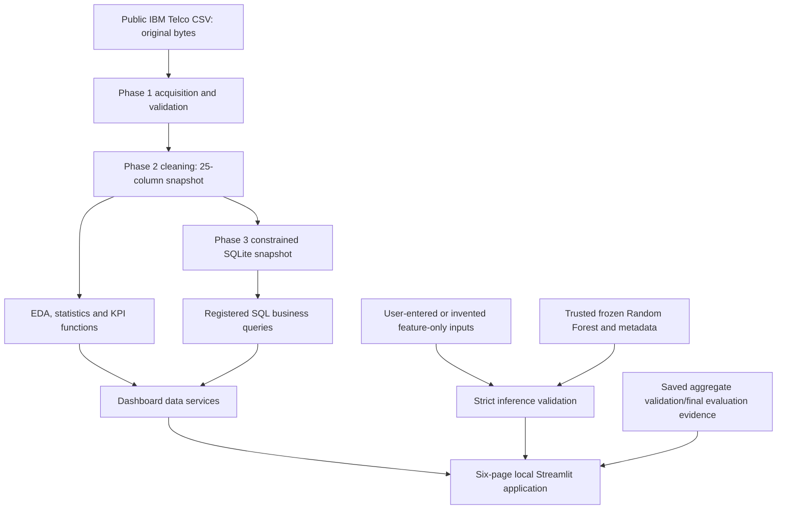
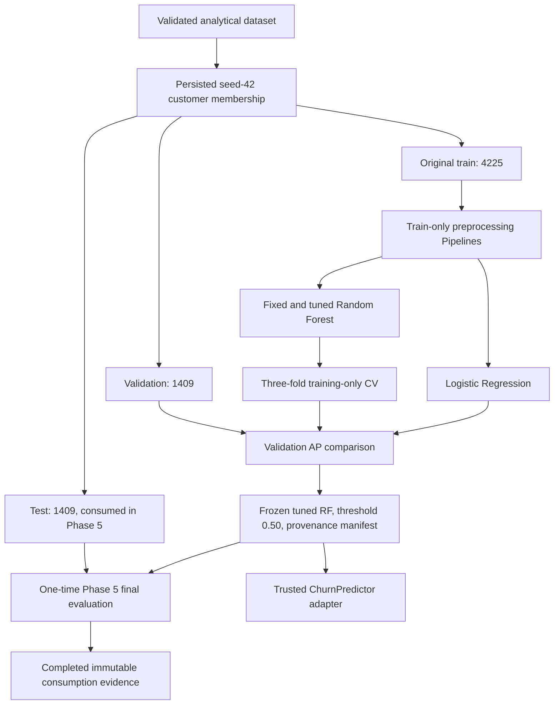

> Publication-copy note: this guide documents the historical complete local
> project. Trusted datasets/models/provenance and private audit logs are withheld
> from this source release. See [asset requirements](PUBLIC_RELEASE_ASSETS.md),
> [current verification](PUBLICATION_VERIFICATION.md) and
> [new authentic captures](screenshots/README.md). Historical development commands
> are for review; do not retrain frozen models or reopen the consumed test.

# System architecture and integrity policy

The final system has two distinct workflows: read-only application use now, and
historical model development recorded in earlier phases. Phase 7 does not reopen
training, model selection or the consumed test partition.

## Analytical and application flow

All source/data paths derive from `data.PROJECT_ROOT` or `app/Home.py`'s location.
The entrypoint inserts the project src directory; this works outside the project
working directory, although launch from the root is recommended to load the theme.
No app path depends on an author's home directory. Historical verification reports
contain execution paths and remain unchanged private review evidence.

## Historical modeling flow — not a rerun instruction

Historical training used the same 18 eligible features: tenure/MonthlyCharges plus
16 categorical fields. IDs, Churn, ChurnFlag, TotalCharges, its missingness flag and
redundant analytical bands were excluded. CV preprocessing remained inside each
fold. The winner was not refitted on train+validation. The selected 150-tree RF
(depth 6, leaf minimum 2, max_features=0.5, unweighted, seed 42) remains untouched.

## Module boundaries

| Area | Existing responsibilities |
|---|---|
| `data.py` | Original CSV acquisition, generic diagnostics, strict canonical acquisition/F02 |
| `cleaning.py` | Validated cleaning, missingness/group derivation and CSV reload |
| `analytics.py`, `plots.py`, `reporting.py`, `phase2.py` | Descriptive KPIs/statistics, EDA figures and reports |
| `database.py`, `sql_analytics.py`, `sql_performance.py`, `sql_reporting.py`, `phase3.py` | SQLite schema/ingestion, registered SELECTs, reconciliation and historical benchmarks |
| `model_splits.py`, `modeling.py`, `phase4.py` | Original split provenance, feature normalization, guarded historical LR development |
| `random_forest.py`, `model_comparison.py`, `phase5_data.py`, `phase5.py` | Historical train-only RF/CV, comparison and frozen selection |
| `final_evaluation.py` | Historical one-time claim/evaluation guard; never called by dashboard QA |
| `inference.py` | Shared normalization and trusted fitted LR/RF scoring/F01 |
| `dashboard/artifacts.py` | Fixed artifact/report allowlists, frozen metadata/model checks |
| `dashboard/data.py` | Identifier-free analytics, filters, segment summaries and numerically ordered histogram bins |
| `dashboard/sql.py` | Nine aggregate questions, readonly URI, authorizer and bound values |
| `dashboard/prediction.py` | Complete feature contract, bounded CSV parsing and fixed-threshold scoring |
| `dashboard/exports.py`, `dashboard/cache.py` | Curated exports and separated public-data/model caching |
| `dashboard/components.py`, `dashboard/views/`, `app/` | Shared layout and six presentation pages |

Phase 7 corrects only histogram category ordering and narrow-viewport KPI/header
layout, adds four narrow regression tests, and finalizes documentation/exclusions.
It does not redesign the working services or modify frozen modeling source.

## Safe inference workflow

1. Resolve the fixed selected artifact inside the trusted local bundle.
2. Validate selection identity, metadata consistency, exact 18 features, threshold
   0.50, completed one-attempt ledger, model hash, saved summary hash and sklearn version.
3. Load through `load_churn_predictor()`, never arbitrary uploaded pickle/joblib.
4. Validate complete application inputs and structural phone/internet dependencies.
5. Canonical normalization shares `modeling.select_features()` with historical
   development; numeric/exact-string SeniorCitizen 0/1 remain equivalent.
6. Score submitted inputs without learning; label probability >=0.50 as Churn.
7. Retain current uploaded scores in session memory only and preserve row order.

The general adapter retains the fitted model's missing-value behavior; the app
requires complete inputs and imposes tenure 0–72, charges 0–200. These application
bounds do not change fitted preprocessing or model parameters.

## Read-only analytics, SQL and exports

Analytical views reuse Phase 2 definitions. Full-snapshot descriptive analytics are
allowed; they are not evaluation of predictions on a held-out partition. Customer
IDs are removed before the application caches analytical data. Histograms are
aggregated and retain numeric interval order before formatting category labels.

SQL opens a fresh readonly connection and additionally enforces query_only plus an
authorizer denying writes, DDL, ATTACH, write PRAGMAs and extension loading. The
nine-question allowlist excludes individual-customer ranking query 16. Parameters
are validated and bound; no unrestricted SQL or user-controlled query path exists.

Public exports are known aggregate summaries or the current upload's generated
row index/scores. They exclude raw records, original customer IDs, per-customer
historical predictions, the database and full provenance metadata. CSV text cells
are escaped against formula-leading values. This is curated protection, not a
universal anonymizer or a production security certification.

## Model and test integrity policy

The permanent authoritative ledger is `reports/phase5/test_consumption.json`.
It records the single completed Phase 5 evaluation. Do not delete/modify it, rerun
final evaluation, select from test scores or regenerate final predictions. Phase 4's
unchanged reserved-test flag is historical, not current permission.

The frozen selection binds code and evidence hashes. Do not alter inference,
modeling, split, cleaning or evaluation code bound by that manifest as part of
an application workaround. Request authorization for any proposal that changes a
protected artifact or needs a new independent evaluation plan.

The private review ZIP intentionally omits `final_test_predictions.csv`; the app
and saved aggregate display do not need it. Original protected bytes remain local.
Never bypass the consumption ledger to compensate for that deliberate omission.

## Operational assumptions and limits

The verified environment is macOS/Python 3.13.9 with recorded versions. No package
installation or fresh-platform build occurred in Phase 7. Local artifacts must be
restored from the trusted bundle, not retrained after a source-only clone. Caches
never train, and uploads are not globally cached. Localhost defaults are not a
public-hosting configuration. Authentication, remote transport, concurrent-user
privacy, scale, dataset-shift monitoring and prospective model validity remain
outside this local portfolio demonstration.
